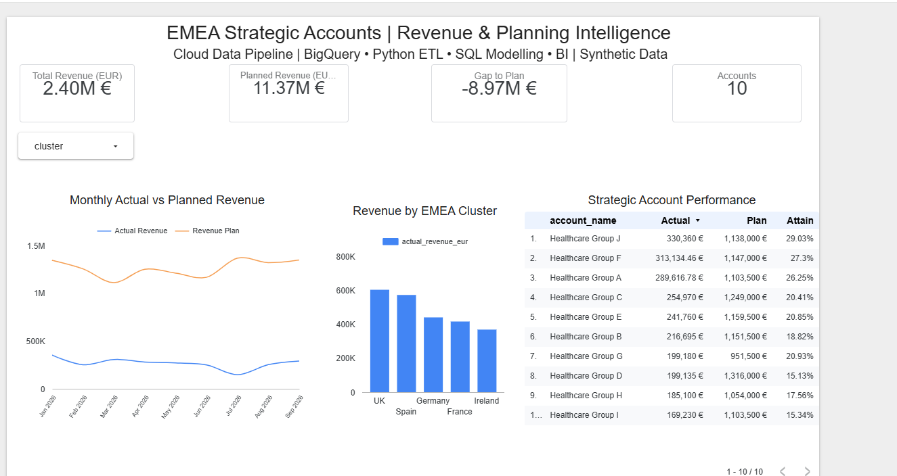

# EMEA Revenue Intelligence | Cloud Data Engineering & BI

An end-to-end cloud analytics project integrating synthetic CRM, ERP billing, account master, FX and business planning data to create a reliable strategic-account reporting platform.

## Business Problem
Commercial data across multiple European markets often contains inconsistent customer identifiers, duplicate invoices, different currencies and disconnected revenue plans. This project demonstrates how to transform those sources into a governed reporting layer.

## Architecture
Excel/CSV → BigQuery Raw Tables → Python ETL (Google Colab) → BigQuery Analytical Tables → Google Sheets Snapshot → Data Studio Dashboard

## Technologies
Python, Pandas, Google Cloud BigQuery, SQL, Google Colab, Google Sheets, Data Studio and GitHub.

## Results
- Processed 261 raw invoice records.
- Identified and removed one exact duplicate.
- Standardised inconsistent currency codes.
- Reconciled 259 invoices with the account master.
- Quarantined three invalid or unmatched invoices.
- Produced 257 validated invoices representing €2.40M in synthetic revenue.
- Created monthly revenue and IBP planning comparisons across 10 strategic accounts.

## Dashboard
The dashboard includes revenue KPIs, actual-versus-plan trends, cluster comparisons, account performance and interactive filtering.

## Interactive BI Dashboard

The dashboard includes:
- Actual versus planned revenue trends
- Revenue performance by EMEA cluster
- Strategic account rankings and target attainment
- Interactive cluster filtering

Note: Dashboard data comes from a Google Sheets
snapshot exported from BigQuery.

## Limitations
This is an educational batch-processing prototype using entirely synthetic data. The dashboard is connected to an exported Google Sheets snapshot rather than a live BigQuery connection. Production scheduling, access controls and monitoring are future enhancements.
